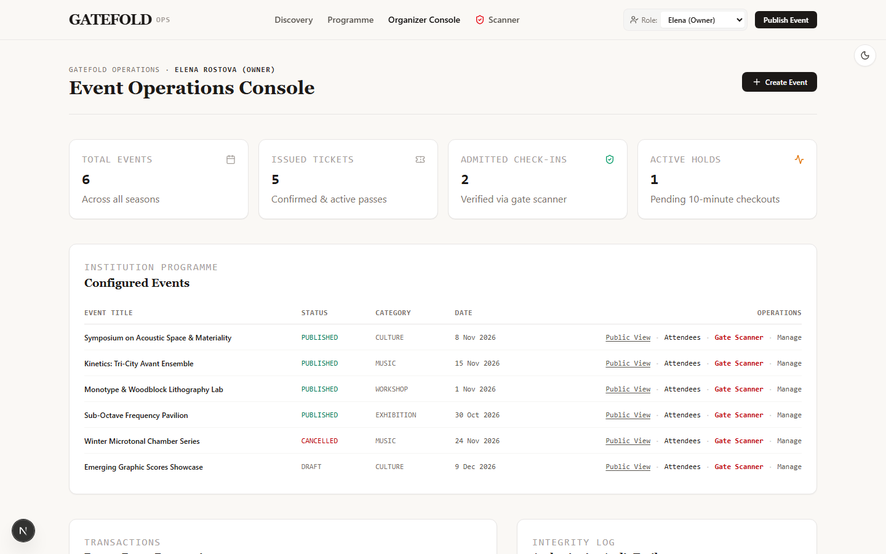
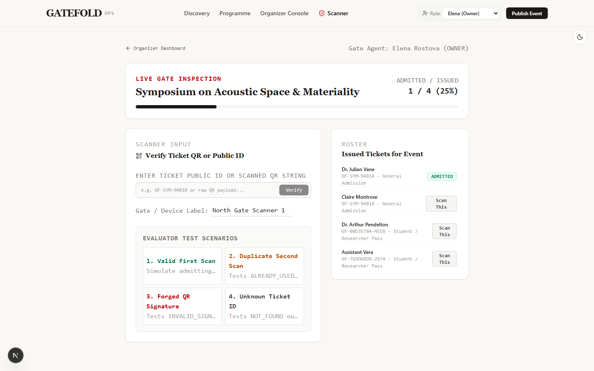

# Gatefold

Gatefold is an event publishing and ticket operations platform for independent
organizers, venues, festivals, and conferences. It couples a public discovery
surface with an organizer console for inventory, reservations, ticket
issuance, and attendee check-in.

## Live Demo

[](https://gatefold.vercel.app)


### Demo status

The live deployment runs the full product against an embedded PostgreSQL
(PGlite) instance in memory. The demo programme reseeds on every cold start,
and checkout is simulated with no real payment processing. Use the role
switcher in the top bar to explore the Owner, Manager, and Gate Staff
personas.

## Screenshots






## Features

- Public programme: browse and reserve tickets across published events with
  live inventory counts.
- Atomic inventory holds: 10-minute server-enforced holds with zero
  overselling, backed by PostgreSQL transactions and an explicit invariant
  check.
- Signed QR tickets: every issued ticket carries an HMAC-SHA256 signature
  that is validated against database state at the gate.
- Organizer console: publish and manage events, monitor attendees, and
  assign roles across Owner, Manager, and Gate Staff personas.
- Check-in scanner: scan, verify, and admit tickets with explicit handling
  for already-used, forged, and unknown codes.
- Role-scoped operations: demo personas exercise the same permission matrix
  that would gate a production deployment.

## Stack

| Layer | Technology |
| --- | --- |
| Framework | Next.js 15 (App Router) |
| Language | TypeScript 5.9 (strict) |
| UI | React 19, Tailwind CSS v4, lucide-react |
| Database | PGlite (embedded PostgreSQL, WASM) |
| Tests | node:test via Bun |
| CI | GitHub Actions |
| Hosting | Vercel |

## Quick start

```bash
bun install
bun run dev
```

Open http://localhost:3000. The database is created, migrated, and seeded
automatically on first boot.

### Scripts

```bash
bun run dev        # development server on port 3000
bun run build      # production build
bun run start      # serve the production build
bun run lint       # eslint
bun run typecheck  # tsc --noEmit
bun test           # authoritative inventory suite
```

## License

MIT
